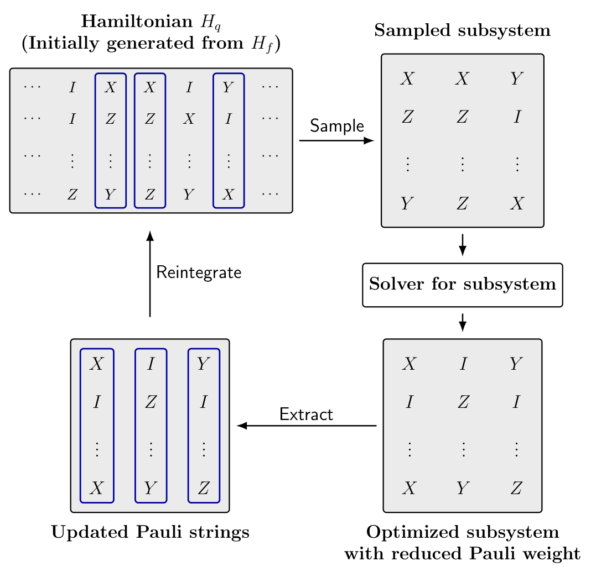

# Randomized Subsystem Descent for Fermion-to-Qubit Mapping.

Optimizing fermion-to-qubit mappings by randomized subsystem descent. An arXiv paper is available at [arXiv](https://arxiv.org/abs/2604.17630).

This is a joint work by [Gengzhi Yang](https://genz17.github.io/), [Di Wu](https://woody2357.github.io/), [Haizhao Yang](https://haizhaoyang.github.io/), [Xiaodi Wu](https://www.cs.umd.edu/~xwu/) and
[Ji Liu](https://programinquantum.com/).
